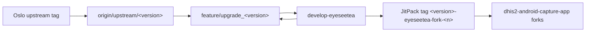
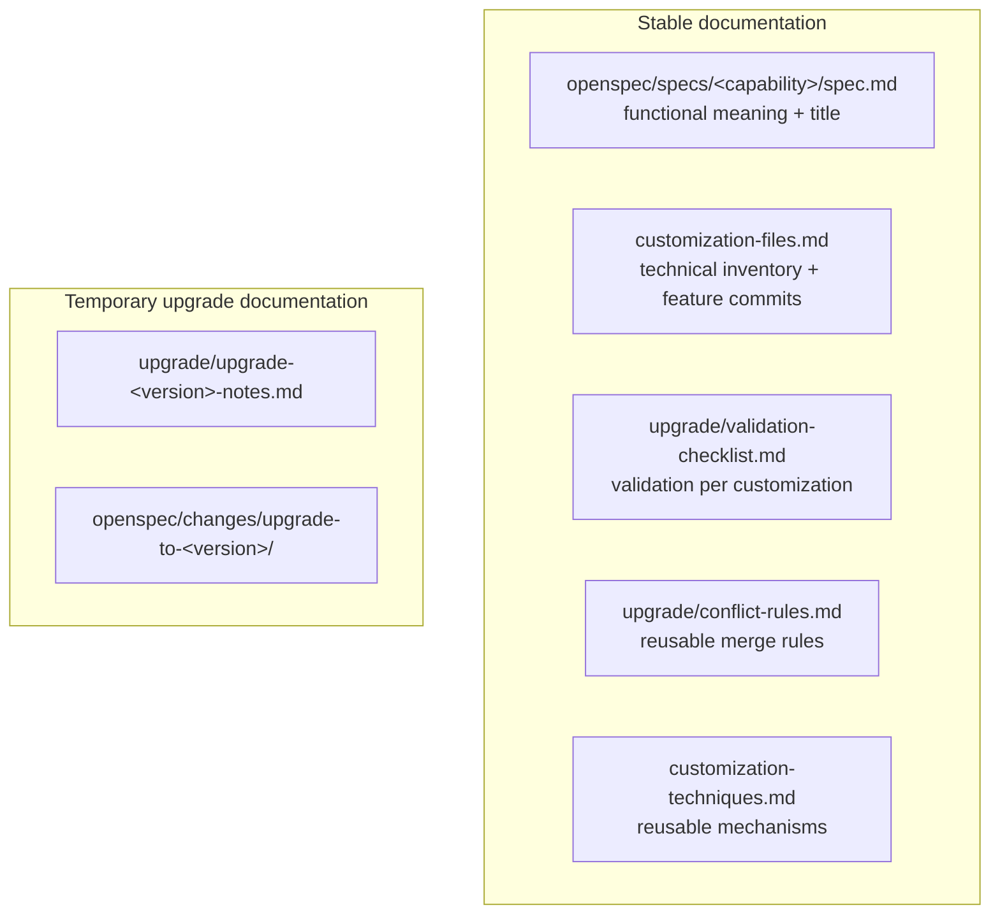
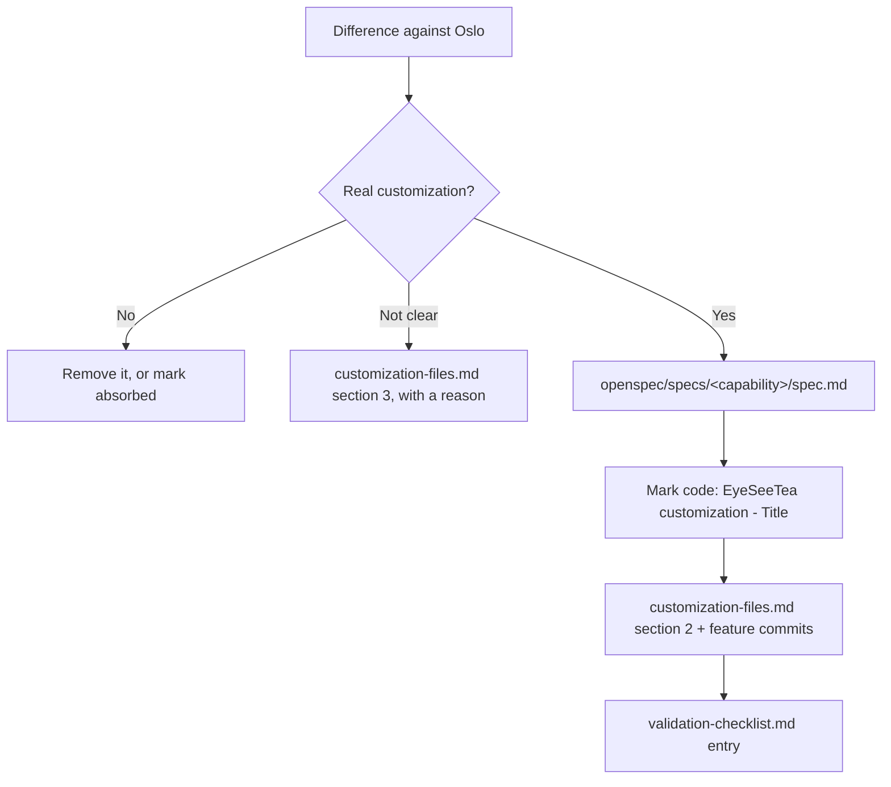

# EyeSeeTea Docs

This folder documents the EyeSeeTea fork of the DHIS2 Android SDK
(`dhis2-android-sdk`), published on JitPack as
`com.github.EyeSeeTea:dhis2-android-sdk` and consumed by the EyeSeeTea fork of
the Capture app (`EyeSeeTea/dhis2-android-capture-app`, `develop-eyeseetea` and
its client branches).

It follows the same documentation model as the app's `eyeseetea-docs/`, adapted
to a repository with a single fork layer.

## Who this README is for

- `Developer`
  Confirms which differences are real customizations, reviews uncertain
  cases, and validates the final behavior.
- `AI agent`
  Inspects branches and diffs, classifies conflicts, resolves low-risk ones,
  drafts specs and inventory entries, and keeps upgrade notes, under the rules
  documented here.

## Model: one fork, no client layer

The app has two layers: Oslo upstream → `develop-eyeseetea` shared baseline →
per-client branches (`oca`, `simprints`, ...).

This repository has one: **Oslo upstream (`dhis2/dhis2-android-sdk`) →
`develop-eyeseetea`**. Every customization ships in the same artifact to every
consumer, even when one client asked for it (e.g. OCA's synced-data retention
purge). So there are no `customizations/<client>/` folders, no per-client
checklist, and no `new-fork.md`. The fork guidance lives in a single
`AGENTS-eyeseetea.md` at the repository root.

## Golden rules

- upgrade from a **tagged** Oslo release, never from `upstream/develop`
- never assume a diff against Oslo is a real customization without checking
  what the code does and why
- one OpenSpec spec per customization; its top-level `# <Title>` is the single
  name used everywhere else
- keep temporary upgrade progress in `upgrade/upgrade-<version>-notes.md`, never
  in the stable documents
- before inventing a way to change Oslo code, check `customization-techniques.md`

## What gets written where

- `openspec/specs/<capability>/spec.md`
  Source of truth for what each customization does: human title (top-level
  `#` heading), purpose, SHALL/MUST requirements, WHEN/THEN scenarios.
- [`customization-files.md`](customization-files.md)
  Source of truth for where each customization lives: implementation points,
  supporting files, status, feature commits, and the drift not yet classified.
- [`upgrade/validation-checklist.md`](upgrade/validation-checklist.md)
  Source of truth for how each customization is validated after an upgrade.
- [`upgrade/conflict-rules.md`](upgrade/conflict-rules.md)
  Source of truth for reusable merge rules.
- [`customization-techniques.md`](customization-techniques.md)
  Catalogue of mechanisms for changing Oslo behavior with the least conflict
  surface.
- [`upgrade/upgrade-plan.md`](upgrade/upgrade-plan.md)
  Upgrade runbook.
- `upgrade/upgrade-<version>-notes.md` (from
  [`upgrade/template/upgrade-notes-template.md`](upgrade/template/upgrade-notes-template.md))
  Temporary notes for one upgrade. Deleted when the upgrade closes.

The title of a customization must be identical in four places: the spec's
`# <Title>`, the section heading in `customization-files.md`, the section
heading in `validation-checklist.md`, and the code comment
`// EyeSeeTea customization - <Title>`.
[`scripts/check_upgrade_docs.py`](scripts/check_upgrade_docs.py) checks it.

## Lifecycle of a customization

New customizations follow the normal OpenSpec flow (`/opsx:propose` →
`/opsx:apply` → `/opsx:archive`). The archive step syncs the delta into
`openspec/specs/`; check afterwards that the spec still starts with its human
`# <Title>` and add the `customization-files.md` and checklist entries.

## Onboarding the existing customizations

Most of this fork's customizations predate this documentation model. Before
the next Oslo upgrade they are inventoried once, following the app's
`onboarding-fork-guide.md` phases 3 and 4:

1. **Inventory (narrative draft).** List every EyeSeeTea-only commit
   (`git rev-list --no-merges develop-eyeseetea --not --remotes=upstream <oslo tags>`),
   group them into customizations, and classify each one against the target
   Oslo version: `active`, `absorbed` (Oslo now does the same), or `removed`.
   The draft lives in `upgrade/upgrade-<version>-notes.md`.
2. **Developer review.** A developer who knows the fork confirms titles,
   intent, and status. The agent must not invent titles or treat a diff as a
   customization without this confirmation.
3. **Formalize.** One `openspec/specs/<capability>/spec.md` per active
   customization, its section 2 entry and feature commits in
   `customization-files.md`, its checklist entry, and titled markers in code.
   `openspec validate --specs` and `check_upgrade_docs.py` must pass.
4. **Clean up.** Remove absorbed or obsolete code, and leave section 3 of
   `customization-files.md` empty or with an explicit reason per entry.

## Read this if...

### I want to know what is customized in this SDK fork

Read `openspec/specs/` (what) and `customization-files.md` (where).

### I am upgrading this fork to a newer Oslo version

Read `upgrade/upgrade-plan.md` and follow its phases; it points to
`upgrade/conflict-rules.md` for the merge rules and to `customization-files.md`
for what must survive.

### I just built a customization and need to document it

Make sure its spec exists in `openspec/specs/`, mark the code with
`// EyeSeeTea customization - <Title>` (see `upgrade/conflict-rules.md`), add its
section 2 entry and feature commits to `customization-files.md`, add its
validation entry, and run `python3 eyeseetea-docs/scripts/check_upgrade_docs.py`.

## Related

- [`EyeSeeTea.md`](../EyeSeeTea.md) (repo root) — how this fork is published to
  JitPack and consumed locally (composite build).
- [`AGENTS-eyeseetea.md`](../AGENTS-eyeseetea.md) (repo root) — fork guidance
  for AI agents, imported from `CLAUDE.md`.
- App-side docs: `eyeseetea-docs/` in `EyeSeeTea/dhis2-android-capture-app` —
  the client-fork model and how the app consumes this SDK.
